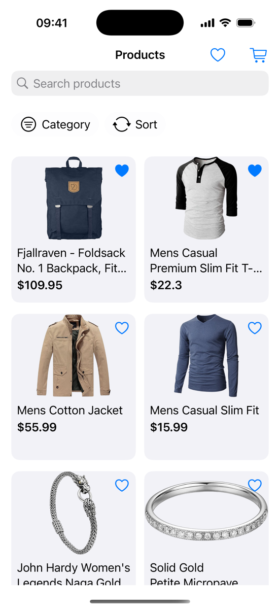
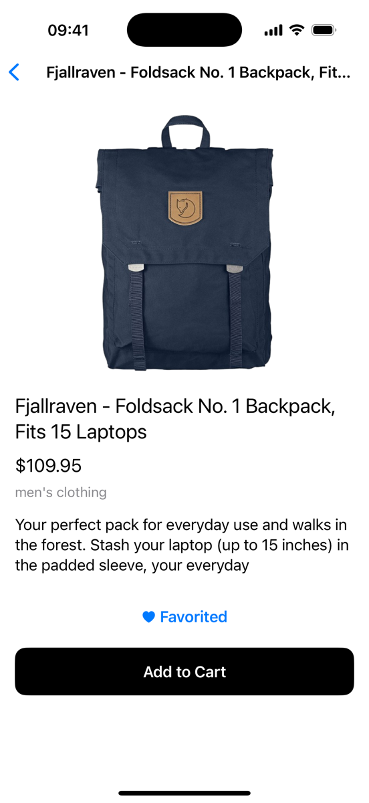
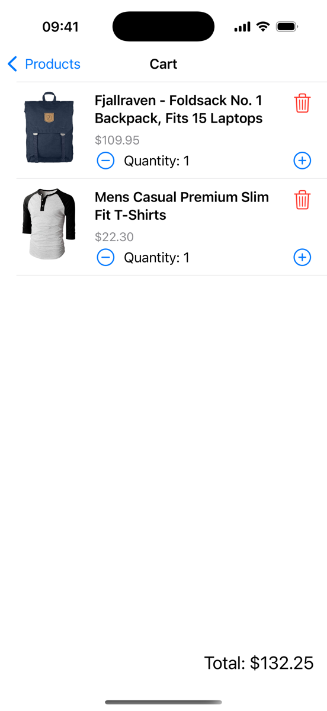
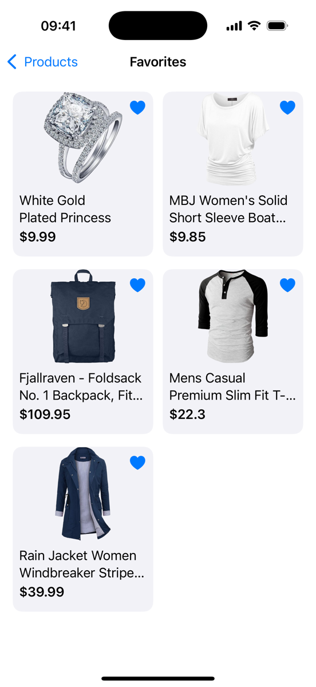
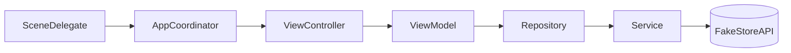

# MarketPilot

An iOS e-commerce app built with **UIKit and programmatic UI** (no storyboards), backed by [FakeStoreAPI](https://fakestoreapi.com). It started as an MVC app and was refactored step by step into **MVVM-C**.

| Products | Detail | Cart | Favorites |
|---|---|---|---|
|  |  |  |  |

## Features

- Product list with loading, empty and error states
- Search, category filter and sorting (price or title, ascending or descending)
- Product detail with add to cart and favorite toggle
- Cart with quantity changes, item removal and total price
- Favorites persisted with `UserDefaults`
- Async image loading with `NSCache` and task cancellation on cell reuse

## Architecture



- **AppCoordinator** is the composition root: it creates shared dependencies once (services, repository, cart and favorite managers) and owns navigation. View controllers never push screens; they expose closures such as `onProductSelected`, and the coordinator decides where to go.
- **Dependencies are protocol-typed and injected through initializers**, so any layer can be replaced with a test double.
- **ViewModels import only `Foundation`.** They do not know about UIKit or their view controller. A ViewModel publishes a state enum (`idle / loading / loaded / empty / error`) through a closure, and the view controller renders it.
- **Concurrency:** networking uses `async/await`; ViewModels and view controllers are `@MainActor`, so UI updates always happen on the main thread.

## From MVC to MVVM

The first version was plain MVC. As features were added (search, category filter, sorting), `ProductListViewController` was holding the product data, the filtering logic and the UI at the same time, and none of that logic could be tested without a screen.

The refactor moved data and filtering into `ProductListViewModel`, added a Repository between the ViewModel and the network service, and moved navigation into a coordinator. The product list and product detail screens are now MVVM; Cart and Favorites are still MVC and are the next migration step.

## Testing

19 unit tests written with **Swift Testing**, covering `CartManager` and `ProductDetailViewModel`. Test doubles such as `InMemoryFavoriteStorage` are injected through protocols, so tests never touch `UserDefaults` or the network.

```bash
xcodebuild test -project MarketPilot.xcodeproj -scheme MarketPilot \
  -destination 'platform=iOS Simulator,name=iPhone 16' -only-testing:MarketPilotTests
```

## AI-Assisted Workflow (Claude Code)

The project was built in two phases, and the git history reflects both:

1. **May–September 2026:** I wrote the app, including the MVC → MVVM-C refactor, using AI chat as a mentor for explanations and code review.
2. **From September 2026:** I added Claude Code to the repository. I still write most of the app code myself; for well-defined tasks (tests, tooling, smaller changes) I use a **spec → generate → review** loop: I write a short spec, Claude Code generates the change, and I review it before committing. Commits produced this way carry a `Co-Authored-By: Claude` trailer. I also set up the Claude Code configuration below so that this loop stays safe and verifiable.

The repository includes:

- **Instructions:** `CLAUDE.md` (architecture, commands, conventions) and a test-only rule file in `.claude/rules/` that loads only when test files are touched
- **Guardrails** (`.claude/settings.json`): force push, `git reset --hard` and `rm -rf` are denied; `git commit` and `git push` require my approval
- **Build-check hook:** if a Swift file changed, the build must pass before Claude Code can finish a task
- **Skills:** `ios-review` (reviews a ViewModel or view controller against the MVVM rules), `run-tests`
- **Agents with limited permissions:** `test-writer` writes tests but cannot edit production code; `reviewer` is read-only

## Known Limitations

- Cart and Favorites screens are still MVC
- `ProductListViewController` reads favorite state directly from `FavoriteManager` instead of its ViewModel
- The detail screen's ViewModel supports quantity changes, but the stepper UI is not built yet
- The cart is in memory only and is cleared when the app closes
- `ProductListViewModel` has no tests yet
- `URLSession.shared` is not injected, so `ProductService` cannot be tested without the network
- Errors are logged with `print`; the error screen has no retry action
- No accessibility or localization support

## Requirements

Xcode 16.4 · iOS 18.5+ · No third-party dependencies
